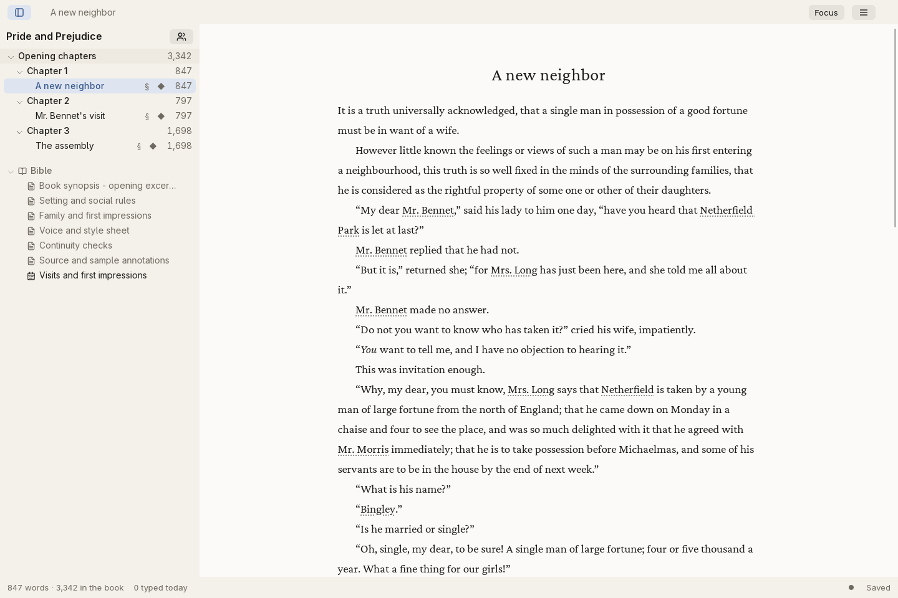
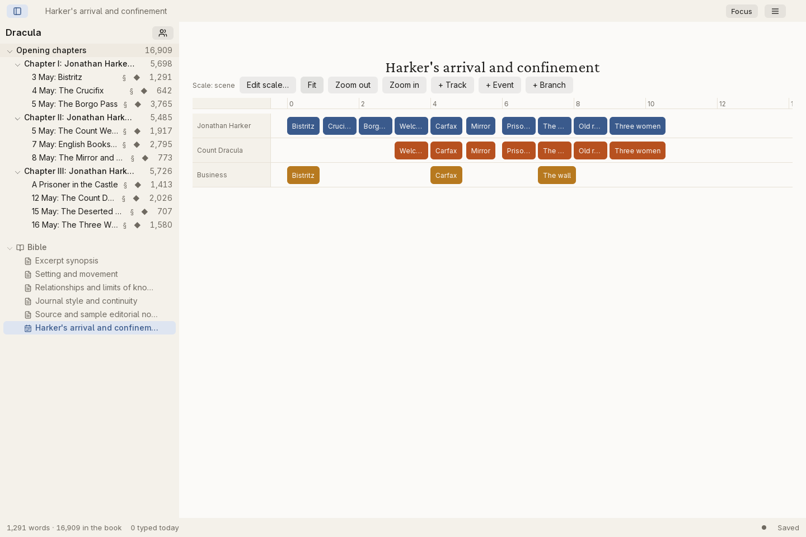
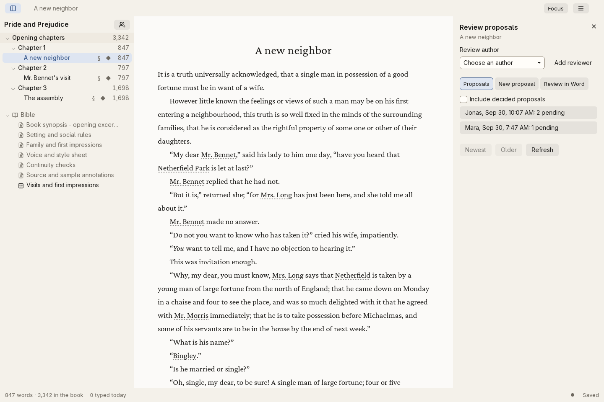
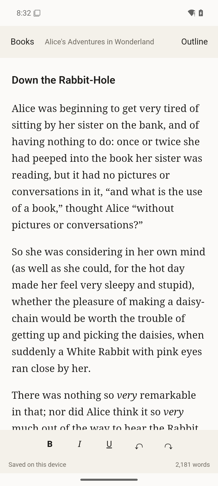
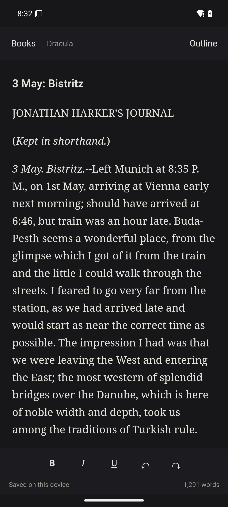

<p align="center">
  <picture>
    <source media="(prefers-color-scheme: dark)" srcset="assets/brand/garret/garret-wordmark-paper.png">
    
  </picture>
</p>

New desktop books offer Novel, Short fiction, Nonfiction, and Story collection project types.
Short fiction starts with one scene and grows structure as needed. Nonfiction
starts with its own book design, calls the Bible Reference notes, and keeps
fiction tools available under Planning > More. A single-scene manuscript
exports without generated contents or outline headings; front and back matter
remain included. Collections keep stories in one book, with their own titles,
optional authors, status and word counts. Use Story details from a story's
navigator context menu to edit its fields or export it alone in Markdown, EPUB,
PDF or Word. See [collection export rules](docs/COMPATIBILITY.md).

## A writing studio for the whole book.

**garret**  is a powerful writing studio for novelists, completely free and open
source. It brings your manuscript, story planning, research, and revisions
into one app.

There are no subscriptions or paid feature unlocks. You don't need an account
or an internet connection to write. Your books stay on your own disk.

> **Early alpha.** garret moves fast; keep backups of your work.

The current published build is [0.0.4 alpha](https://github.com/iuliandita/garret/releases/tag/v0.0.4).
See [published and development changes](docs/RELEASES.md) and the
[compatibility and rollback guide](docs/COMPATIBILITY.md).

Development builds keep schema 17 and refuse unsupported document writes.
Legacy books with empty text runs remain recoverable; see the compatibility guide.



[Website](https://usegarret.com) | [Full screenshot gallery](docs/screenshots/README.md) | [Sample books](app/fixtures/classics/README.md)

[Recovery and compatibility](docs/COMPATIBILITY.md) | [Contributing](CONTRIBUTING.md) | [Security](SECURITY.md) | [Help](https://github.com/iuliandita/garret/issues/new?labels=question)

## Write, plan, and revise

Write in a calm editor with formatting, book-wide search, undo/redo, and
scene history. Arrange parts, chapters, and scenes with outlines and cards.
Choose light or dark mode, in English or German.

### Keep the story straight

Build a story bible for your world, notes, and continuity rules. Keep character
profiles, aliases, pictures, and appearances alongside your manuscript. Write
scene synopses, connect research files, and use the timeline to follow events
across character and story tracks.



### Work with your editor

Send a DOCX review document to your editor and import the returned changes
with attribution. Accept or reject proposals in garret, keep comments attached
to the text, and organize the next draft into revision passes and tasks.



### Prepare the book

Export to Markdown, DOCX, or EPUB, or make a PDF proof copy. Set up book design,
chapter openers (ornament, its position, how far down the text area a chapter starts),
front and back matter (including a References page, marked as a bibliography in EPUB),
covers, and pen names before exporting.

The EPUB and PDF previews sit beside your prose in a rail you can widen by
dragging its divider or with the arrow keys; the width is remembered on that
device. An optional e-reader or tablet frame shows an approximate paged view,
and an optional refresh runs after you stop typing.

### Keep control of your work

Books live on your own disk. Recovery copies, scene history, salvage tools,
and a readable mirror folder help you recover work. Encrypted portable archives
include a separate recovery key. An optional PIN lock conceals the app when
you step away; it does not encrypt manuscript files.

Series, optional session analytics, and local craft and consistency reports
are included too. All of these tools are free.

## Platforms

| Platform | |
| --- | --- |
| Linux | x86_64, glibc 2.39+, WebKitGTK 4.1 |
| Windows | x86_64, WebView2 |
| Android | Writing and editing on the go |
| macOS | Apple Silicon and Intel alpha builds; native testing needed |

Get [alpha testing builds from GitHub Releases](https://github.com/iuliandita/garret/releases),
or [build garret from source](#building-from-source-linux).

<p>
  
  
</p>

## Testing builds

Download alpha builds from [GitHub Releases](https://github.com/iuliandita/garret/releases).
Choose the download for your device and follow the included instructions.
Windows `-setup.exe`, Linux `.deb`, `.rpm` and `.AppImage`,
and macOS `.dmg` installers are available alongside the portable archives. See the
[installation guide](docs/INSTALLING.md) for setup, upgrades and removal. Android uses an APK; the phone app has fewer
features and does not sync books automatically. Keep a backup before trying a
new build. See [compatibility and recovery](docs/COMPATIBILITY.md) for stored-format
limits and salvage output.

### Verify a download

Releases from 0.0.3 include a signed `SHA256SUMS` manifest and GitHub artifact
attestations. Older releases have only per-file checksums.

Release signing key fingerprint: `8270 74C7 C4A2 9486 FB48  BC00 8B54 EB1A DBE5 8725`

Import the [public key](docs/release-signing-key.asc) and compare its full
fingerprint with this page and [SECURITY.md](SECURITY.md). Download `SHA256SUMS`,
`SHA256SUMS.asc`, and the release files with their `.sha256` sidecars into
one directory, then run:

```sh
gpg --verify SHA256SUMS.asc SHA256SUMS
sha256sum -c SHA256SUMS
gh attestation verify <file> --repo iuliandita/garret
```

If you downloaded only the files for your platform, check those present with:

```sh
sha256sum -c --ignore-missing SHA256SUMS
```

On macOS, use `shasum -a 256 -c --ignore-missing SHA256SUMS` instead.
Missing files are skipped; confirm that each intended download reports `OK`.

Replace `<file>` with each downloaded file, including the manifest and signature.
The manifest covers all packaged downloads and checksum sidecars; it excludes
itself and its detached signature. Checking the complete manifest requires all
listed files. A missing signature means GPG verification is unavailable; see the
[code signing policy](docs/SIGNING.md) for current platform signing and fallback.

### Android updates with Obtainium

[Obtainium](https://github.com/ImranR98/Obtainium) installs each new Android
release for you:

1. Add `https://github.com/iuliandita/garret` as an app source.
2. Pick the asset whose name ends in `-android.apk`, for example
   `garret-0.0.4-android.apk`. The `-android-info.zip` asset holds instructions
   and build details; it is not installable.
3. Check the signing certificate. Obtainium shows the certificate hash for the
   installed app on its app page; the SHA-256 digest must be
   `BD:DD:33:9D:88:32:A6:37:8D:BD:04:71:E4:1A:3D:21:48:F4:41:1F:A8:B0:04:C6:B5:52:4C:93:F6:68:4A:92`.
   To read it from a downloaded APK, run `apksigner verify --print-certs` from
   the Android SDK build-tools, or `keytool -printcert -jarfile`, and compare
   the reported certificate SHA-256 digest.

An installed copy keeps updating in place only while the package name and the
signing key stay the same. Android now uses `com.usegarret.app`, with the same
signing key as `cc.local.app`. It installs next to the old app. First update
the old app to the transfer-capable 0.0.3 release and export each book with its
separate recovery key, then install the new app and import those archives.
Keep the old app until you have checked the imported books, notes and pictures.
See the [one-time Android move](scripts/android/README.md#one-time-package-move).

## Building from source (Linux)

You need [Bun](https://bun.sh), a stable Rust toolchain, and the
[Tauri 2 Linux prerequisites](https://v2.tauri.app/start/prerequisites/#linux)
(WebKitGTK 4.1 development packages).

```sh
bun install
cd app/ui && bun run build && cd -
cd app/shell-tauri/src-tauri && cargo build --release && cd -
scripts/run-app
```

`scripts/run-app` rebuilds the interface, builds the host on first use, and
starts the app. `scripts/install-desktop-entry` adds a menu entry for that
launcher, using application identifier `com.usegarret.app` on desktop and
Android. See [upgrade compatibility](docs/COMPATIBILITY.md) for native
profile preservation. Release-style packages come from `scripts/package-linux`,
`scripts/package-windows`, `scripts/package-macos` and `scripts/package-android`.

## Checks

See [CONTRIBUTING.md](CONTRIBUTING.md) for development setup, checks, and
pull request instructions.

## Where your work lives

New books default to `Documents/Books` until you choose another folder.
On Linux, settings and recovery copies default to `~/.local/share/garret/`.
Migrated profiles retain a compatibility link at the former `cc.local.app`
location. Pictures and research originals sit next to each book, so back up a book's
`.db` file together with those folders, with the app closed.

If garret stops while preparing its application data, keep both folders named in
the warning. Close every version of garret and back up both folders separately
before attempting recovery. Do not delete, merge or overwrite either folder.
Request recovery help and include the warning, removing personal paths before
posting it publicly. A symbolic link inside the old profile also stops the move;
garret does not follow it or remove it for you.

### Keep a safe copy of your book

Keep your working book outside cloud-synced folders. **File > Copies > Create recovery point** makes a
local recovery copy; it cannot protect your work if you lose the device.

1. Open **File > Copies > Encrypted backups**.
2. Choose **Create recovery key** and keep the key separately from your backups.
   A lost key means you cannot restore an encrypted archive.
3. Select **Choose backup folder**, then **Make encrypted archive** and save
   the archive there. Use a Google Drive or Dropbox synced folder, or a USB
   drive. You can also copy the archive there afterward.
4. Use **Verify encrypted archive** to check the saved archive with your key.

garret remembers the backup destination folder. Making and saving each archive
is manual. **Restore encrypted archive** restores it as a separate book.

### Move a book between desktop and Android

On Android, open the book, open **Outline**, then choose **Export book**.
Use an existing recovery key, or save a new key first. Keep the key separately
from the archive. The app saves a complete encrypted `.age` archive through
the system file picker, including picture and retained research originals.
A successful export means the chosen file was closed and read back with the
same length and hash; it does not verify a provider's later cloud upload.
On desktop, use **Restore encrypted archive** with that archive and key.

To move a desktop book onto the phone, make an encrypted archive on desktop,
then choose **Import archive** in the Android library. Pick the archive and
its separate key, review the book title and any related local copies, and
choose **Keep both as separate books** (or **Import as a separate book**).
Open the new copy from the library. Existing books and source files stay intact.
This is a manual copy, not synchronization or merging.

The phone accepts archives up to 1 GiB and contents up to 512 MiB, with extra
private storage required for verification and copying. This Android version
supports absent, `novel`, `short`, `nonfiction`, and `collection` project presets; other presets are refused
before editable opening. See [compatibility and recovery](docs/COMPATIBILITY.md)
for interrupted transfers, leftover-file disposal, updates, and verification
limits. Android transfer is not certified on physical devices.

### If a backup was interrupted

Open the error's **Details** for the exact parent directory and retained folder.
Close garret, preserve a local copy of that folder, and inspect it first.
Application-private temporary files may contain unencrypted writing; keep them
out of cloud folders. To list retained folders, replace the placeholders below
with the parent directory and folder name from Details:

```sh
garret archive-stage-list "<parent-dir>"
```

Only after inspecting and preserving the selected folder, deliberately discard
its temporary files with:

```sh
garret archive-stage-clean "<parent-dir>" "<stage-name>"
```

Then retry the backup. For destination temporary encrypted files, choosing another
backup folder also works while keeping the retained files. Another filename in
the same folder does not help. Changing the backup folder cannot bypass retained
application-private files.

## Help

For setup or recovery questions, [open a question issue](https://github.com/iuliandita/garret/issues/new?labels=question). Include the app version, operating system, and the warning or steps involved. Remove personal paths and manuscript content before posting. Use the [bug report form](https://github.com/iuliandita/garret/issues/new?template=bug.yml) for failures and the [private reporting process](SECURITY.md) for security problems.

## Support development

If you would like to support development, you can
[leave a tip on Ko-fi](https://ko-fi.com/Q3O027XM2F). It is entirely optional;
every feature remains free.

## License

garret is free software under the GNU General Public License, version 3 or
later; see [COPYING](COPYING). Third-party notices are in
[THIRD-PARTY-NOTICES.md](THIRD-PARTY-NOTICES.md).

Made by [Iulian Dita](https://iuliandita.com). [Other projects](https://iuliandita.com/projects/).
